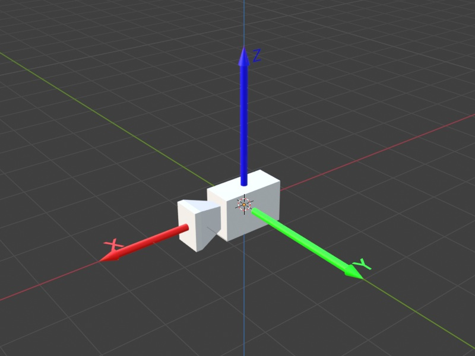
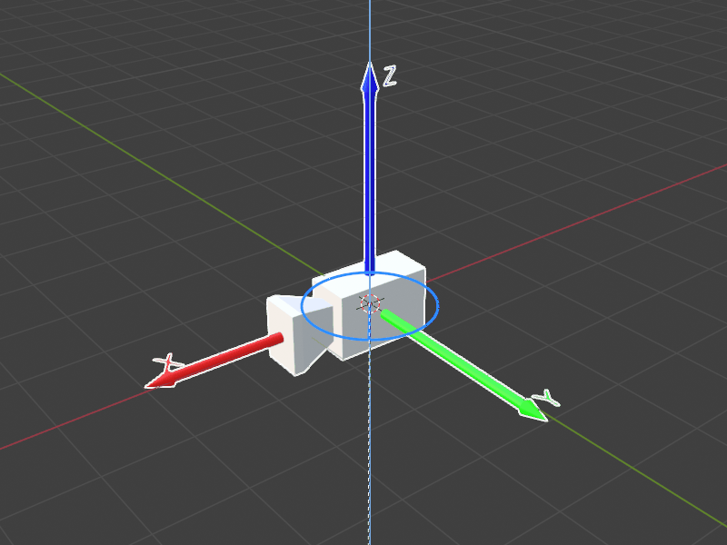
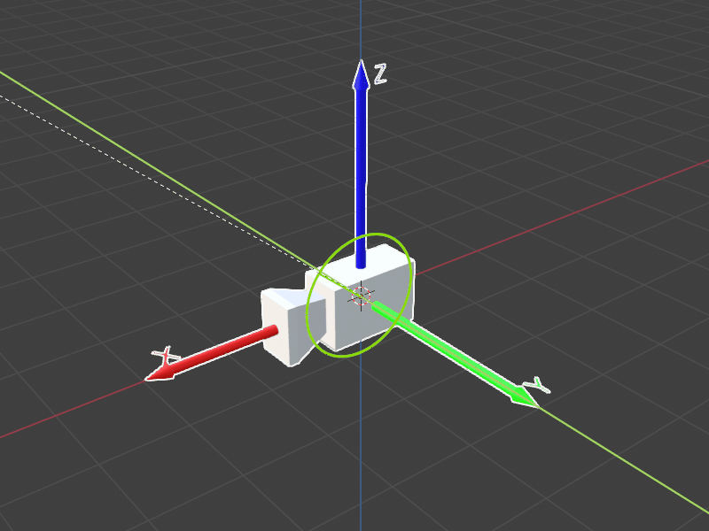
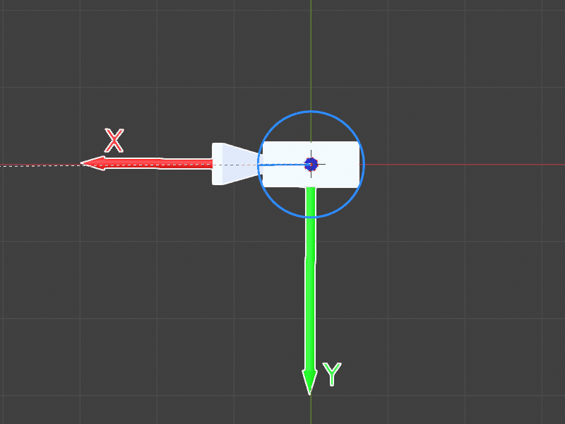
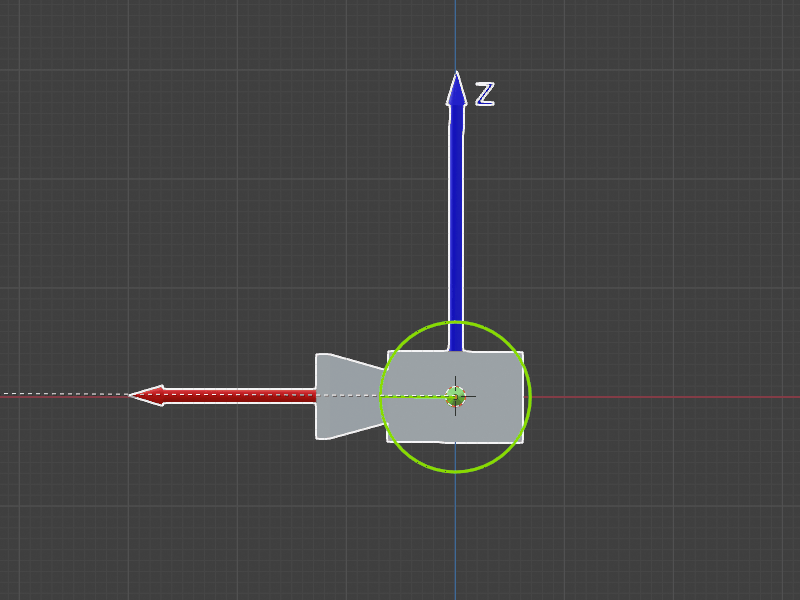

# Projekt Scorpio - zadanie rekrutacyjne do działu Software

> **Uwaga!** Przed przystąpieniem do realizacji zadania przeczytaj **całe** README i pamiętaj, żeby wypełnić [formularz rekrutacyjny](https://www.scorpio.pwr.edu.pl/rekrutacja/).

## Spis treści
- [Informacje ogólne](#informacje-ogólne)
- [Zadania do wykonania](#zadania-do-wykonania)
- [Specyfikacja techniczna zadania](#specyfikacja-techniczna-zadania)
- [Wskazówki i przydatne linki](#wskazówki-i-przydatne-linki)

## Informacje ogólne
Zadanie wykorzystuje symulację dwu-osiowej platformy obrotowej, w której za pomocą stworzonego przez nas API można sterować dwoma silnikami oraz dokonywać odczytu wartości ich enkoderów obrotowych (wytłumaczenie, czym jest enkoder znajdziesz w tym [artykule](https://stoltronic.pl/pl/blog/post/43/enkoder-zasada-dzialania-rodzaje-budowa?page_type=post)). Silnik numer 1 jest odpowiedzialny za ruch w osi poziomej, zaś numer 2 w pionowej.

Uznajemy, na potrzebę zadań, że na osi pionowej zamontowana jest kamera, którą możemy się rozglądać sterując silnikami.

Zadanie wymaga instalacji ROS2 Humble i silnie zalecamy korzystania w tym celu z Ubuntu 22.04. Jeżeli nie chcesz instalować na swoim komputerze nowego systemu, to można zrealizować zadanie np. używając [devcontainera](https://code.visualstudio.com/docs/devcontainers/containers).

Wszystkie zadania należy wykonać w języku C++.

Rozwiązane zadanie należy umieścić w **publicznym** repozytorium (np. GitHub), które jest forkiem tego repozytorium, i przesłać link do tego forka na mail projekt@scorpio.pwr.edu.pl. Ewentualne pytania lub wątpliwości co do treści zadania można kierować na tego samego maila. Zadania przyjmujemy do **02.11.2026** do końca dnia.


## Zadania do wykonania
W tej części znajdziesz treść poszczególnych zadań. Szczegółowe informacje dotyczące symulacji oraz jej implementacji znajdziesz w sekcji [specyfikacja techniczna zadania](#specyfikacja-techniczna-zadania).

Pamiętaj, że zadanie służy sprawdzeniu wielu umiejętności - nie tylko programowania i znajomości algorytmów -  więc nawet w przypadku zrealizowania tylko części z poniższych punktów, zachęcamy do przesłania rozwiązania. Postępy w zadaniu powinny być udokumentowane w repozytorium na githubie (po każdym etapie zadania powinien zostać stworzony nowy commit).

1. **Konfiguracja ROS'a i zbudowanie przykładu**

  - Należy zainstalować ROS2 Humble zgodnie z [oficjalną instrukcją](https://docs.ros.org/en/humble/Installation.html) na odpowiedni system.
  - Należy [utworzyć workspace ROS-owy](https://docs.ros.org/en/humble/Tutorials/Beginner-Client-Libraries/Creating-A-Workspace/Creating-A-Workspace.html), stworzyć fork tego repozytorium, i sklonować ten fork do folderu `src` w workspace.
  - To repozytorium jest paczką ROS2 zawierającą symulację platformy obrotowej oraz przykładowego node'a, w którym umieścisz swoje rozwiązanie.
  - Należy zbudować workspace, zsourceować go, i uruchomić symulację:

  ```bash
  colcon build
  source install/setup.bash
  ros2 launch scorpio_zadanie_rekrutacyjne_software platform.launch.py input_file:=src/scorpio_zadanie_rekrutacyjne_software/commands.txt
  ```

  - Cele zadaje się **plikiem tekstowym** podanym w argumencie `input_file`. W repozytorium czeka gotowy `commands.txt`, opisany w sekcji [plik z celami](#plik-z-celami). Ścieżka względna jest liczona od katalogu, w którym uruchamiasz `ros2 launch` (powyższa komenda zakłada, że jesteś w katalogu workspace'u) - możesz też podać ścieżkę bezwzględną.
  - Uruchomienie ładuje do jednego kontenera dwa node'y: `backend::RosInterface` (symulacja) oraz `solution::Solution` (twoje rozwiązanie). Na tym etapie zostanie wykonany przykład zawarty w `solution::Solution` w `/src/solution/solution.cpp` - wypisze on otrzymane cele i wprawi w ruch silnik numer 1.
  - Node'y wystawiają pięć topiców, opisanych w sekcji [dokumentacja API](#dokumentacja-api). Należy przetestować działanie symulacji komendami `ros2 topic echo` oraz `ros2 topic pub` (w drugim terminalu, po zsourceowaniu workspace'u):

  ```bash
  ros2 topic echo /scorpio/motor_1/encoder
  ros2 topic pub /scorpio/motor_1/control std_msgs/msg/Int8 "{data: 100}"
  ```

2. **Dojazd do pojedynczego celu**

  - Zostanie Ci przesłany pojedynczy punkt. Należy obrócić obydwoma silnikami tak, aby kamera patrzyła na ten punkt.

  Przykład testowy - wklej go do pliku i podaj przez `input_file:=`:

  ```
  0 1 1 0
  ```


3. **Dojazd do wielu celów (priorytet ostatniego)**

  - Zostanie przesłana arbitralna liczba punktów w odstępach niewiększych niż 10 sekund. Każdy punkt należy obsłużyć dokładnie tak jak w poprzednim zadaniu. Jeżeli podczas dojazdu do celu zostanie zadany kolejny cel, należy obecny cel porzucić.
  - W tym zadaniu należy uruchamiać program z argumentem `preempt:=true`.

  Przykład testowy:

  ```
  0 1 1 0
  10 1 1 1
  1 -1 0 0
  3 1 1 0
  ```


4. **Dojazd do wielu celów (kolejka)**

  - Zostanie przesłana arbitralna liczba punktów w odstępach niewiększych niż 10 sekund. Należy każdy z tych punktów obsłużyć dokładnie tak jak w zadaniu 2, dojeżdżając do każdego po kolei, bez wywłaszczenia.
  - W tym zadaniu **nie należy** ustawiać `preempt:=true`.

  Przykład testowy:

  ```
  0 1 1 0
  10 1 1 1
  1 -1 0 0
  3 1 1 0
  ```

  > **Wskazówka!** Oczekujemy, że sam określisz margines dojechania do celu.

## Specyfikacja techniczna zadania

### Symulacja

#### Wstęp

W tej symulacji operujemy dwoma układami współrzędnych: globalnym (nieruchomy, który opisuje całą przestrzeń, w której porusza się kamera) oraz lokalnym kamery (który obraca się wraz z nią). Wyobraź sobie, że kamera siedzi w punkcie (0,0,0) i może obracać się w poziomie i w pionie - w praktyce nie musimy martwić się fizycznymi wymiarami statywu czy samej kamery, czyli tak naprawdę „kamera wisi w miejscu, a silniki zmieniają jej kierunek patrzenia”.

Silnik 1 odpowiada za obrót w poziomie (jakbyś obracał głowę w lewo i w prawo), a silnik 2 za ruch w pionie (góra-dół). Aby wiedzieć, w jakim kierunku patrzy kamera, korzystamy z enkoderów - to cyfrowe liczniki, które mówią nam, o ile stopni obrócił się dany silnik (zakodowane jako wartość z zakresu [0; 4095]). Symulacja nie zajmuje się mechanicznymi detalami montażu - liczy się tylko matematyka obrotów i przesyłanie odpowiednich sygnałów do silników, tak aby kamera mogła „wycelować” w wskazany punkt w przestrzeni.

#### System współrzędnych i mapowanie enkoderów

Symulacja implementuje dwu-osiową platformę obrotową z następującym układem współrzędnych:

<div style="display: flex; justify-content: center; gap: 10px;">
  
</div>

Na powyższym diagramie kamera znajduje się w pozycji początkowej `(0,0,0)`. Pogrubione osie są osiami układu kamery, zaś cieńkie są osiami układu globalnego. W tej pozycji odczyty z enkoderów będą, dla obu silników, równe 0.

Silnik 1 - Oś pozioma:
- Wartość = 0 → kamera skierowana w kierunku +X
- Wartość rosnąca → silnik kręci się zgodnie z ruchem wskazówek zegara (patrząc na platformę z góry, czyli od strony +Z; z kierunku +X w stronę -Y)
- Steruje obrotem wokół osi Z globalnego układu współrzędnych (cienka niebieska oś)

<div style="display: flex; justify-content: center; gap: 10px;">
  
</div>

Powyższy gif jest wizualizacją sterowania silnikiem 1. Jak widać, obrót odbywa się wokół globalnej (cienkiej) osi pionowej.

Silnik 2 - Oś pionowa:
- Wartość = 0 → kamera skierowana poziomo, równolegle do ziemi (płaszczyzny XY).
- Wartość rosnąca → silnik kręci się do góry
- Steruje obrotem wokół osi Y układu współrzędnych kamery (pogrubiona zielona oś)

<div style="display: flex; justify-content: center; gap: 10px;">
  
</div>

Powyższy gif jest wizualizacją sterowania silnikiem 2. Jak widać, obrót odbywa się wokół osi Y układu kamery (pogrubionej).

<div style="display: flex; justify-content: center; gap: 10px;">
  
  
</div>

Powyższe gify, odpowiednio dla silników 1 i 2, obrazują narastanie wartości enkoderów, zaczynając od 0. Tzn. na początku odczyt będzie równy 0 i wraz z czasem będzie rósł.

#### Charakterystyka ruchu

Sygnały sterujące:
- Wartości dodatnie (1-127): ruch w kierunku rosnących wartości enkodera
- Wartości ujemne (-128 do -1): ruch w kierunku malejących wartości enkodera
- Wartość 0: brak ruchu

Dynamika silników:
- Prędkość obrotu rośnie z kwadratem wartości sygnału sterującego - sygnał 127 to maksymalna prędkość (około 10 stopni na sekundę), sygnał 30 to pełzanie (poniżej 1 stopnia na sekundę).
- Każdy silnik ma własną prędkość maksymalną oraz bezwładność: po zmianie sygnału sterującego silnik potrzebuje chwili, żeby się rozpędzić, a po wysłaniu 0 nie zatrzymuje się natychmiast. Silnik 1 (oś pozioma) jest wolniejszy i bardziej bezwładny niż silnik 2 (oś pionowa).
- Sygnał sterujący obowiązuje do momentu wysłania kolejnego - jeżeli wyślesz 100 i nic więcej, silnik będzie kręcił się w nieskończoność.

Właściwości enkoderów:
- Zakres: 0-4095 (12-bit, cykliczny)
- Cykliczność: enkodery są cykliczne, po pełnym obrocie do 4095 kolejną wartością będzie 0
- Rozdzielczość: 4096 pozycji na pełny obrót (360°)
- Drgania: silnik (co za tym idzie, odczyt enkodera) drga stojąc w miejscu - odczyt może różnić się o 1-2 od faktycznej pozycji
- Częstotliwość odczytu: konfigurowalna (domyślnie 20 Hz)

### Dokumentacja API

> **Uwaga!** Nie należy modyfikować implementacji symulacji. Całe twoje rozwiązanie powinno znaleźć się w katalogach `*/solution`, a punktem wejściowym jest node `solution::Solution` w pliku `solution.cpp`.

Symulacja działa jako node ROS2 (`backend::RosInterface`). Twoje rozwiązanie to drugi node - komunikacja między nimi odbywa się wyłącznie przez topici, więc nie masz dostępu do żadnych obiektów symulacji.

#### Topici

| Topic | Typ | Kierunek | QoS po stronie symulacji |
|-------|-----|----------|--------------------------|
| `motor_1/control` | `std_msgs/msg/Int8` | rozwiązanie → silnik osi poziomej | subskrypcja: reliable, volatile |
| `motor_2/control` | `std_msgs/msg/Int8` | rozwiązanie → silnik osi pionowej | subskrypcja: reliable, volatile |
| `motor_1/encoder` | `std_msgs/msg/UInt16` | enkoder silnika 1 → rozwiązanie | publikacja: reliable, volatile, 20 Hz |
| `motor_2/encoder` | `std_msgs/msg/UInt16` | enkoder silnika 2 → rozwiązanie | publikacja: reliable, volatile, 20 Hz |
| `target` | `geometry_msgs/msg/Point` | symulacja → rozwiązanie | publikacja: reliable, transient local |

Nazwy są względne wobec namespace'u node'a (`/scorpio`), czyli pełna nazwa to np. `/scorpio/motor_1/encoder`.

Domyślne QoS w `rclcpp` (np. `create_publisher<...>("motor_1/control", 10)` i `create_subscription<...>("motor_1/encoder", 10, ...)`) jest zgodne ze wszystkimi powyższymi topicami, więc nie musisz nic konfigurować. Dla enkoderów możesz też użyć `rclcpp::SensorDataQoS()`. Topic `target` jest publikowany jako *transient local*: jeżeli Twoja subskrypcja też będzie *transient local* (tak jak w przykładzie w `solution.cpp`), to dostaniesz również cele wysłane zanim Twój node zdążył wystartować. Jeżeli w logach zobaczysz ostrzeżenie `requesting incompatible QoS` / `offering incompatible QoS`, to znaczy, że QoS Twojego publishera/subskrypcji nie pasuje do symulacji i wiadomości nie będą dostarczane.

### Argumenty launcha

Program uruchamia się wyłącznie przez `ros2 launch`:

| Argument | Domyślnie | Opis |
|----------|-----------|------|
| `input_file` | - | Plik z celami; **wymagany** |
| `preempt` | `false` | Włącza tryb wywłaszczania (potrzebny do zadania 3) |
| `debug` | `false` | Włącza tryb debugowania symulacji (verbose output) |
| `encoder_period` | `0.05` | Okres aktualizacji enkoderów (w sekundach) |

```bash
# uruchomienie z domyślnymi ustawieniami
ros2 launch scorpio_zadanie_rekrutacyjne_software platform.launch.py input_file:=src/scorpio_zadanie_rekrutacyjne_software/commands.txt

# zadanie 3 - z wywłaszczaniem
ros2 launch scorpio_zadanie_rekrutacyjne_software platform.launch.py input_file:=src/scorpio_zadanie_rekrutacyjne_software/commands.txt preempt:=true

# podgląd tego, co robi symulacja
ros2 launch scorpio_zadanie_rekrutacyjne_software platform.launch.py input_file:=src/scorpio_zadanie_rekrutacyjne_software/commands.txt debug:=true
```

Symulacja sama się nie kończy - program działa aż do `Ctrl+C`.

### Plik z celami

Format pojedynczego celu jest następujący:
`<delay> <X> <Y> <Z>`

- `delay` -> określa w jakim odstępie czasowym od poprzedniego celu zostanie zadany ten cel
- `X`, `Y`, `Z` -> współrzędne celu w przestrzeni 3D

Puste linie oraz wszystko po znaku `#` są pomijane, więc plik możesz komentować. Gotowy przykład znajdziesz w `commands.txt` w katalogu głównym repozytorium.

Przykład:

```shell
5 1 2 3 # (1,2,3) zadany po 5 sekundach działania symulacji
5 5 5 5 # (5,5,5) zadany po kolejnych 5 sekundach
10 9 8 7 # (9,8,7) zadany po kolejnych 10 sekundach
1 2 3 4 # (2,3,4) zadany po kolejnej sekundzie
```

## Wskazówki i przydatne linki

- Zadanie rekrutacyjne można oddać niepełne.
- Symulacja ma testy jednostkowe - `colcon test` po zbudowaniu workspace'u uruchamia je, a `colcon test-result --verbose` pokazuje wynik.
- Rozwiązane zadanie należy umieścić w **publicznym** repozytorium (np. GitHub) i przesłać link do tego repozytorium na mail projekt@scorpio.pwr.edu.pl. Ewentualne pytania lub wątpliwości co do treści zadania można kierować na tego samego maila. Termin znajdziesz w [informacjach ogólnych](#informacje-ogólne).
- [Czym jest enkoder](https://stoltronic.pl/pl/blog/post/43/enkoder-zasada-dzialania-rodzaje-budowa?page_type=post)
- [ROS2 Humble crash course](https://www.youtube.com/watch?v=Gg25GfA456o)
- [Oficjalna dokumentacja ROS2 Humble](https://docs.ros.org/en/humble/index.html)
- [Oficjalna dokumentacja RCLCPP](https://docs.ros.org/en/humble/p/rclcpp/)
- [Composable nodes w ROS2](https://docs.ros.org/en/humble/Concepts/Intermediate/About-Composition.html)

**Jeżeli będziesz mieć jakiekolwiek wątpliwości i problemy z zadaniem śmiało skontaktuj się z nami na maila projekt@scorpio.pwr.edu.pl! Powodzenia :)**